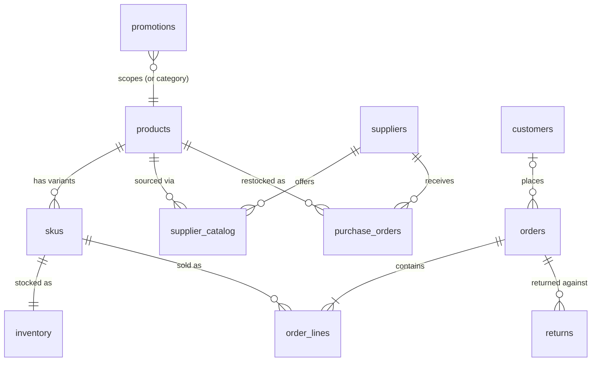

# Retail Store Agent

An AI agent that runs a small retail store — rings up sales, processes returns,
restocks from suppliers, manages promotions, and answers analytics questions —
through a plain conversational CLI.

```
You: Put all hoodies on 20% off from 2026-06-20 to 2026-06-22, then ring up
     one Gray Medium hoodie dated 2026-06-21 and tell me the price.

  [tool: create_promotion({"description": "Hoodie 20% off", ...})]
  [tool: create_order({"items": [{"sku": "HOOD-GRY-M", "quantity": 1}], ...})]

Agent: Created promotion PR-2 (20% off hoodies, Jun 20–22) and rang up order
       O-1017 for one Gray Medium hoodie on 2026-06-21. With the promotion
       applied, the price is $48.00 (down from $60.00).
```

## Reliability: idempotency guard and fault-injection evals

Agents that take real actions retry and repeat themselves. This repo has a
fault-injection eval that scores pass^k, not pass@1, plus a guard (idempotency
ledger, per-turn intent keys, DB-level rules, invariant alarms). Against the
original tools pass^5 was 0.00 with 59 duplicate writes; with the guard it is
1.00 with 0.

```bash
python3 -m evals.runner --guard off --k 5    # DB fixes only (pass^5 0.50)
python3 -m evals.runner --guard on  --k 5    # gate passes
```

Details and full results: [RELIABILITY.md](RELIABILITY.md).

## Quick start

```bash
pip install -r requirements.txt
cp .env.example .env        # put your API key in .env
python main.py
```

That's it — the database is created and seeded from `data/*.csv` on first run.
To reset the store to its initial state, delete `store.db` and run again.

### Bring your own model

The agent runs on **any LLM with tool calling**. Put whichever credential you
have in `.env` and it auto-detects the provider:

| Provider | What you need | Default model |
|---|---|---|
| **Anthropic (Claude)** | `ANTHROPIC_API_KEY` | `claude-sonnet-4-6` |
| **OpenAI (ChatGPT)** | `OPENAI_API_KEY` | `gpt-4o` |
| **Google (Gemini)** | `GEMINI_API_KEY` (free at aistudio.google.com/apikey) | `gemini-2.5-flash` |
| **Local (Ollama)** | `ollama serve` running — no key | `qwen2.5:7b` |

Force a specific provider with `LLM_PROVIDER=anthropic|openai|gemini|ollama`,
and override models with `ANTHROPIC_MODEL` / `OPENAI_MODEL` / `GEMINI_MODEL` /
`OLLAMA_MODEL`.

**No API key at all?** Run it fully local:

```bash
# install Ollama from https://ollama.com (or: brew install ollama)
ollama pull qwen2.5:7b
python main.py        # auto-falls back to Ollama when no key is found
```

### Run the tests (no API key needed)

```bash
python tests/test_tools.py
```

16 deterministic tests exercise the business rules against the real seed data —
discounted refunds, promotion windows, supplier eligibility, the exact May 2026
margin numbers — without touching an LLM. The agent's judgment varies by model;
the money math never does.

---

## Architecture

```
 You (terminal)
   │
   ▼
 agent/loop.py ──────────── conversation memory (full history per session)
   │
   ▼
 agent/llm.py ─────────────  one interface, four providers
   │        └─ agent/translator.py   canonical tool schema → provider dialect
   ▼
 agent/tools.py ───────────  14 tools = ALL business logic (deterministic)
   │
   ▼
 SQLite (store.db) ────────  schema in agent/db.py, seeded from data/*.csv
```

**Design principle: the LLM decides *what* to do; Python decides *how much it
costs.*** Every business rule from `DATA_DICTIONARY.md` — rounding, discount
proration, promotion windows, supplier eligibility, margin definitions — lives
in the tool layer as tested code. The model never does arithmetic, so answers
are identical whether you run Claude, GPT, or a 7B local model. Smaller models
lose some natural-language finesse but can't get a refund amount wrong.

### Provider abstraction & translator

Tools are defined **once**, in a canonical schema (`agent/tool_definitions.py`).
`agent/translator.py` converts that schema and the message formats into each
provider's dialect — Anthropic `tool_use` blocks, OpenAI `tool_calls`, and
Gemini's native `function_call`/`function_response` parts (via the official
`google-genai` SDK, which is required for Google's new `AQ.`-prefix API keys) —
and appends a stricter tool-calling addendum to the system prompt for local
models, which otherwise tend to *describe* actions instead of calling tools.
Adding a fifth provider is one small adapter class in `agent/llm.py`.

---

## 1. Domain model

The flat CSVs hide one key modeling decision: **a Product is not a SKU.**
A Classic Tee (`P-TEE`) is one product sold as six variants (Blue/Black × S/M/L);
a Canvas Tote is one product with a single unit. Splitting `products.csv` into
`products` + `skus` lets both cases work with no special-casing — selling and
stocking happen at SKU level, purchasing and reporting at product level.



| Entity | Role | Notes |
|---|---|---|
| `products` | conceptual item | `category` = apparel / goods |
| `skus` | sellable unit | color/size NULL for non-variant goods |
| `inventory` | stock per SKU | `on_hand_qty`, `reorder_point`, `reorder_qty` |
| `orders` + `order_lines` | sales | `customer_id` NULL = walk-in; `unit_price` is post-promo, pre-order-discount (matches the CSV convention) |
| `returns` | refunds | `good` restores stock, `damaged` doesn't |
| `promotions` | percent-off windows | scoped to a product or a category; lowest price wins, no stacking |
| `supplier_catalog` | who sells what | cost + lead time drive supplier choice |
| `purchase_orders` | restock tracking | **added entity** (not in CSVs) — receiving goods needs state: qty ordered vs. received, open/closed |

SQLite because the grader runs one command and it works: zero setup, real SQL,
transactions (each order/return commits atomically), and the file survives
restarts.

## 2. Tool layer (14 tools)

Full JSON schemas in `agent/tool_definitions.py`; implementations in `agent/tools.py`.

| Tool | Purpose |
|---|---|
| `lookup_product` | resolve "hoodie in medium" → candidate SKUs (with stock) |
| `lookup_customer` | name → `customer_id` |
| `create_order` | ring up a sale; validates stock, auto-applies promotions by date, decrements inventory, atomic |
| `get_order` / `list_orders` | inspect a sale / query sales by customer or date |
| `create_return` | refund at price **actually paid** (post-discount); restock only if `good` |
| `check_inventory` | stock levels per SKU/product |
| `create_restock_orders` | find everything at/below reorder point; pick cheapest supplier with lead time ≤ 10 days; create POs |
| `receive_purchase_order` | record arrival; partial receipt keeps PO open; creates the PO on the fly if told one exists that doesn't |
| `list_purchase_orders` | open/closed POs |
| `create_promotion` / `list_promotions` | percent-off windows by product or category |
| `get_sales_report` | revenue / COGS / margin per product, ranked; COGS read from Northwind's catalog costs |
| `get_stockout_risk` | flags: below reorder point OR < 14 days of cover (May velocity) |

Tool descriptions carry the disambiguation rules ("scope_ref must be a
product_id like P-HOOD, never a SKU"), which matters more than the system
prompt for keeping smaller models on rails.

## 3. Approach writeup

**Where the intelligence lives.** The agent loop is deliberately tiny
(~60 lines): send history + tools, execute whatever the model requests, feed
results back, repeat until it answers in text. Session memory is the full
conversation history, so "now refund that" resolves naturally. All 125 grader
prompts hit the same 14 tools — the surface area to get right is the tool
schemas and the business rules, not the loop.

**Determinism over vibes.** The assignment freezes the business rules so every
answer is checkable. I treated that as a spec: each rule is implemented exactly
once in SQL/Python (e.g. refund = `round_half_up(unit_price × (1 −
order_discount_pct/100)) × qty`), and the test suite pins the exact expected
numbers from the seed data (May margins: Tee $420.00, Hoodie $282.00, ...).
If a model hallucinated a price, the receipt it reports still comes from the
tool result, not from the model's head.

**Ambiguity is handled, not guessed.** "A hoodie in medium" matches two SKUs
(Gray M, Navy M) — the agent looks up, sees two candidates, and asks which,
rather than silently picking one. "Walk-in" → no customer. "Today" is pinned to
2026-06-19 per the assignment, in code and prompt.

**Edge cases covered.** Insufficient stock rejects the sale (and suggests
restocking) instead of going negative; partial PO receipt keeps the PO open;
damaged returns refund but don't restock; overlapping promotions take the
lowest price; a cheaper-but-slow supplier loses to an eligible one.

**Trade-offs I chose.** No ORM, no framework, three pip dependencies — the
official SDK for each provider family (`anthropic`, `openai`, `google-genai`) —
because for a take-home, review speed beats architecture astronautics. The
`.env` loader is 15 lines instead of a dependency. Restock POs are product-level
(matching `supplier_catalog`), so receiving a multi-variant product doesn't
guess a per-SKU split — a real system would take an allocation.

## Repo layout

```
main.py                  entry point — python main.py
agent/
  config.py              .env loading + provider auto-detection
  llm.py                 Anthropic / OpenAI / Ollama adapters, one interface
  translator.py          canonical tool schema → provider wire format
  loop.py                conversation + agentic tool loop
  prompts.py             system prompt (store context, rules, disambiguation)
  tool_definitions.py    the 14 tool JSON schemas
  tools.py               tool implementations = all business logic
  db.py                  SQLite schema + connection
  seed.py                data/*.csv → store.db (idempotent)
tests/test_tools.py      16 deterministic business-rule tests
data/                    provided CSVs (untouched)
```
